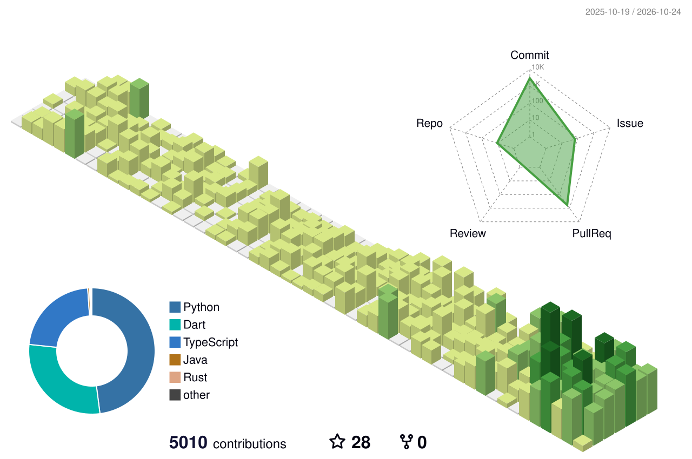

<p align="center">
  <picture>
    <source media="(prefers-color-scheme: dark)" srcset="images/name-dark.svg">
    
  </picture>
</p>

<p align="center">
  Software engineer · Tashkent, Uzbekistan
</p>

<p align="center">
  <a href="https://mehroj.is-a.dev"></a>
  <a href="https://t.me/mekhrojmajidov"></a>
  <a href="https://www.linkedin.com/in/mehroj-r/"></a>
  <a href="mailto:mekhrojmajidov@gmail.com"></a>
</p>

---

I build backend services with Django and Django REST Framework: APIs, the PostgreSQL
behind them, and the deployment around them. Outside work I write small self-hosted
tools, mostly Telegram bots that bring GitHub and Sentry events into chats or turn music
links into tagged audio files, plus a Yandex Music client for Linux written in Rust.

- 🔭 Currently polishing [github-webhook](https://github.com/mehroj-r/github-webhook) and [sentry-webhook](https://github.com/mehroj-r/sentry-webhook), my Telegram bots for GitHub and Sentry events
- 🦀 Writing Rust on the side: [yamarchy](https://github.com/mehroj-r/yamarchy), a Yandex Music client for Linux
- 💬 Ask me about Django, DRF, PostgreSQL or Telegram bots



---

### 📌 Selected projects

| Project | What it is | Stack |
| --- | --- | --- |
| **[github-webhook](https://github.com/mehroj-r/github-webhook)** | Telegram bot that forwards GitHub events to chats; re-run, approve and merge from Telegram | FastAPI, aiogram, PostgreSQL |
| **[sentry-webhook](https://github.com/mehroj-r/sentry-webhook)** | Sentry alerts in Telegram with routing, noise control, digests and issue actions | aiogram, aiohttp, SQLAlchemy |
| **[music-bot](https://github.com/mehroj-r/music-bot)** | Turns YouTube, Yandex Music and SoundCloud links into tagged M4A/MP3 files | aiogram, yt-dlp, SQLAlchemy |
| **[yamarchy](https://github.com/mehroj-r/yamarchy)** | Yandex Music client for Linux: playback daemon with MPRIS2, a CLI and an Omarchy panel | Rust, Tokio, zbus |
| **[url-shortener](https://github.com/mehroj-r/url-shortener)** | Invite-only link shortener with collections, expiring codes and click analytics | DRF, React, PostgreSQL |
| **[django_boilerplate](https://github.com/mehroj-r/django_boilerplate)** | Production-ready Django REST API templates, one branch per setup | Django, Docker |

---

### 🛠 Tech I ship with

**Backend**

[](https://www.python.org/)
[](https://www.djangoproject.com/)
[](https://www.django-rest-framework.org/)
[](https://fastapi.tiangolo.com/)
[](https://docs.aiogram.dev/)

**Data & storage**

[](https://www.postgresql.org/)
[](https://www.sqlalchemy.org/)

**Also writing**

[](https://www.rust-lang.org/)
[](https://www.typescriptlang.org/)
[](https://dart.dev/)
[](https://react.dev/)

**Around the code**

[](https://omarchy.org/)
[](https://www.docker.com/)
[](https://github.com/features/actions)
[](https://docs.astral.sh/uv/)
[](https://docs.pytest.org/)
[](https://docs.astral.sh/ruff/)
[](https://sentry.io/)

---

### 🕰 When I commit

<!--START_SECTION:commit-habits-->
**I'm an Early 🐤**

```text
🌞 Morning                457 commits         ███░░░░░░░░░░░░░░░░░░░░░░   11.28 %
🌆 Daytime                1624 commits        ██████████░░░░░░░░░░░░░░░   40.07 %
🌃 Evening                1371 commits        ████████░░░░░░░░░░░░░░░░░   33.83 %
🌙 Night                  601 commits         ████░░░░░░░░░░░░░░░░░░░░░   14.83 %
```

📅 **I'm Most Productive on Thursday**

```text
Monday                   586 commits         ████░░░░░░░░░░░░░░░░░░░░░   14.46 %
Tuesday                  741 commits         █████░░░░░░░░░░░░░░░░░░░░   18.28 %
Wednesday                538 commits         ███░░░░░░░░░░░░░░░░░░░░░░   13.27 %
Thursday                 859 commits         █████░░░░░░░░░░░░░░░░░░░░   21.19 %
Friday                   612 commits         ████░░░░░░░░░░░░░░░░░░░░░   15.10 %
Saturday                 369 commits         ██░░░░░░░░░░░░░░░░░░░░░░░   09.10 %
Sunday                   348 commits         ██░░░░░░░░░░░░░░░░░░░░░░░   08.59 %
```
<!--END_SECTION:commit-habits-->

---

### 🏢 Where my commits go

<!--START_SECTION:commit-owners-->
| | Where | Commits | Share | Repos |
| :-: | --- | ---: | --- | ---: |
|  | **[Deepen](https://github.com/Deepen-Eco-System)** | 1,884 | `██████░░░░░░` 46% | 2 |
|  | **[iDeal](https://github.com/iDeal-Property-ERP)** | 1,308 | `████░░░░░░░░` 32% | 4 |
|  | **[Personal projects](https://github.com/mehroj-r)** | 497 | `█░░░░░░░░░░░` 12% | 19 |
|  | **[Akademiya AI](https://github.com/Akademiya-AI)** | 345 | `█░░░░░░░░░░░` 9% | 3 |
| 👥 | Other | 19 | `░░░░░░░░░░░░` <1% | 3 |
<!--END_SECTION:commit-owners-->

---

<p align="center"><i>I write code so my future self can question my life choices.</i></p>
